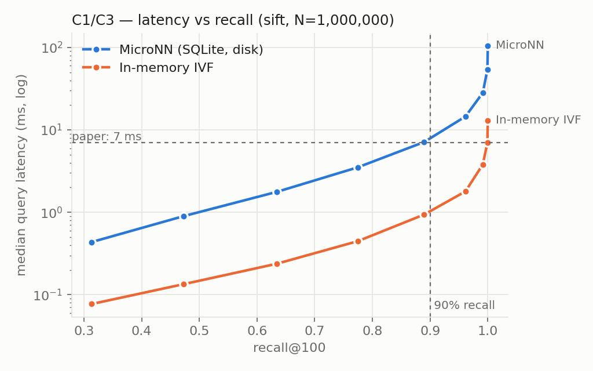
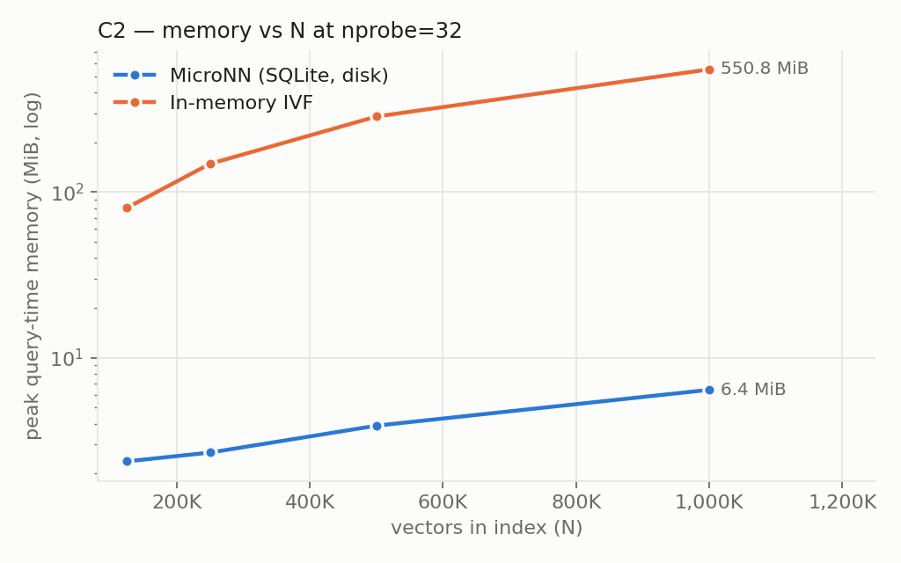
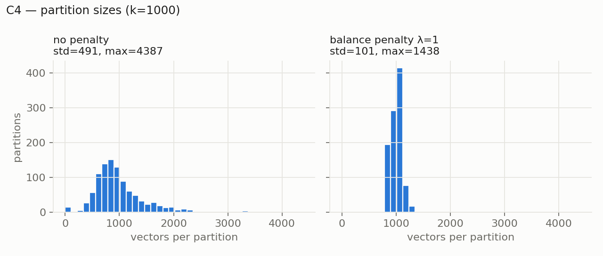
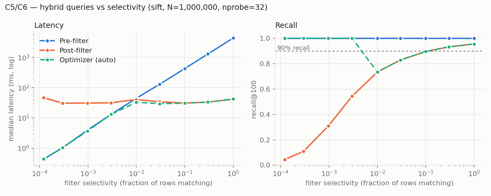
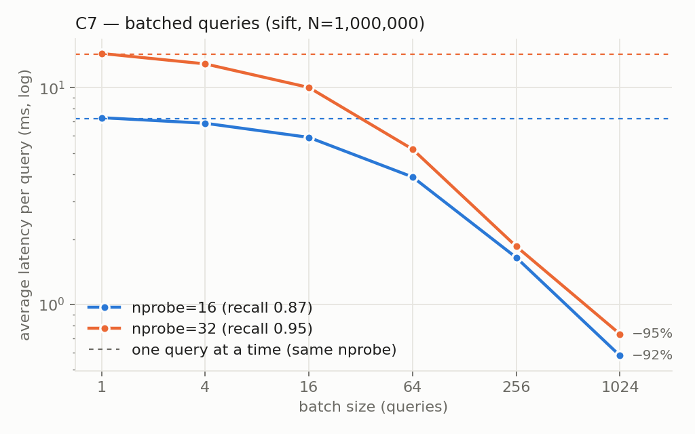
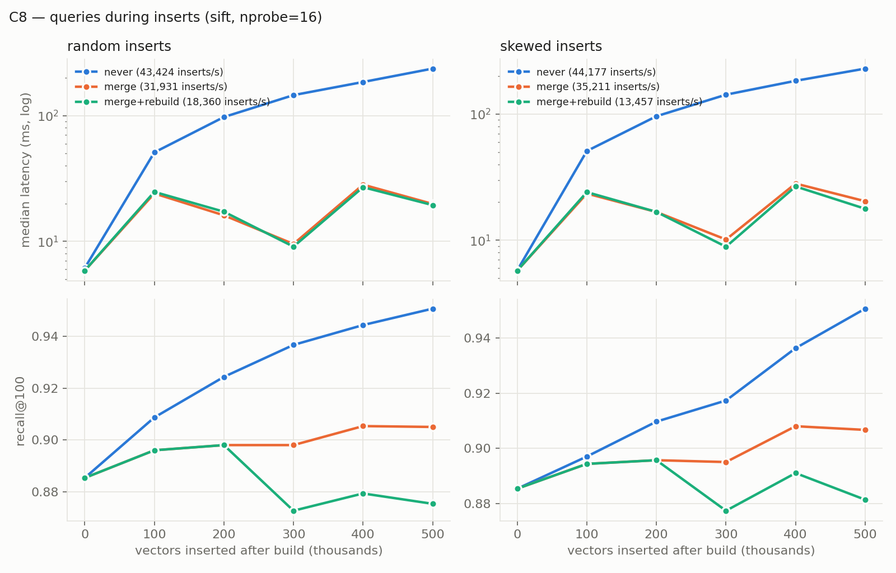
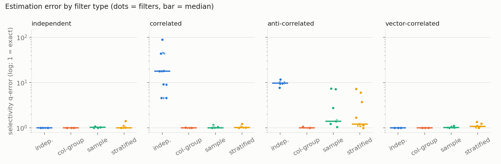
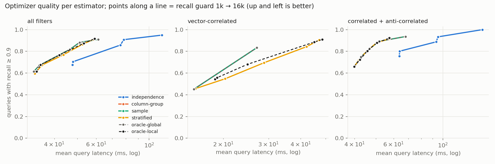

# Re-implementing and Validating MicroNN: an On-device, Disk-resident, Updatable Vector Database

**Keerthana Sudheer** · San José State University · *[add teammates / course number]*

Paper under study: J. Pound et al., *MicroNN: An On-device Disk-resident Updatable Vector Database*,
SIGMOD-Companion '25. https://doi.org/10.1145/3722212.3724444

---

## Abstract

MicroNN is a vector search library from Apple that keeps an IVF index on disk inside SQLite, so it can run on
phones and laptops with little memory, frequent updates and attribute filters. We re-implemented its design from
the paper in about 1,300 lines of Python on SQLite, tested nine of the paper's claims on SIFT1M (1M × 128-d
vectors), and studied one gap the paper leaves open: the independence assumption in its filter optimizer.

Six claims hold in our implementation (low memory, balanced clusters, pre/post-filter behaviour, batching,
updates, transactions), one holds approximately (latency at 90% recall), one holds partially (the optimizer picks
the right plan), and one does not hold in Python (disk latency close to in-memory). The failure traces mostly to
Python driver overhead rather than to the design.

Our most notable results:
- **Memory:** ~10 MB per query at 1M vectors versus ~650 MB for an in-memory version, matching the paper's figure.
- **Batching:** 92–95% lower per-query latency at batch 1024, far above the paper's ~33%.
- **A correctness bug the paper's "ACID for free" framing hides:** a search must read a single snapshot, or a
  concurrent merge can make results duplicate or drop vectors.

The research extension shows that the independence assumption misestimates correlated filters by up to 90×.
Correlation-aware statistics fix the estimates and cut optimizer latency by 22–30% at equal recall. Yet even
perfect selectivity estimates choose the best plan only 83% of the time; the real bottleneck is predicting
*post-filter recall*.

---

## 1. The paper and its claims

Vector search systems usually assume a server with lots of RAM and static data. On a personal device, memory is
small and shared, data changes all the time (e.g., a photo library), and queries combine similarity with filters
("photos from Seattle"). MicroNN addresses this with five ideas:

1. **Disk-resident IVF.** Vectors are clustered and each cluster (partition) is stored contiguously in SQLite via a
   clustered primary key, so a query reads only the few partitions nearest to it.
2. **Memory-bounded clustering.** Mini-batch k-means with a penalty that keeps partition sizes balanced.
3. **Hybrid queries.** An optimizer estimates filter selectivity and picks *pre-filtering* (filter first, then brute
   force: exact) or *post-filtering* (IVF search, then filter: faster, may lose recall).
4. **Batch queries.** Queries that need the same partition share one scan and one matrix multiplication.
5. **Updates.** New vectors go to a delta store that every query scans. It is merged incrementally, with a full
   rebuild only when partitions grow too large. SQLite provides ACID transactions and snapshot reads.

We turned the paper's statements into nine testable claims, each with a pass criterion fixed before running
experiments ([PLAN.md](PLAN.md)):

| # | Claim |
|---|---|
| C1 | Top-100 at 90% recall in under 7 ms |
| C2 | ~10 MB of memory, about 100× less than an in-memory index |
| C3 | Disk-resident latency close to in-memory |
| C4 | Mini-batch k-means builds with bounded memory; the penalty balances partitions |
| C5 | Pre-filter has 100% recall and wins for selective filters; post-filter wins for broad ones |
| C6 | The optimizer picks the right plan |
| C7 | Batching cuts average latency by ~33% at batch size 1024 |
| C8 | Updates via the delta store keep queries fast and correct |
| C9 | ACID transactions and snapshot reads come for free from SQLite |

> Note: claim numbers (7 ms, 10 MB, 33%) are taken from our reading of the paper; verify against the PDF before
> submission.

## 2. Implementation

| Module | What it does |
|---|---|
| [`micronn/storage.py`](micronn/storage.py) | SQLite schema, WAL mode, a 2 MB page cache (imitating a small device), vector (de)serialization |
| [`micronn/clustering.py`](micronn/clustering.py) | Streaming mini-batch k-means (k-means++ init on a reservoir sample) with a size-balance penalty |
| [`micronn/index.py`](micronn/index.py) | Build, partition-pruned search, pre/post-filter plans, delta store, merge/rebuild, snapshot reads |
| [`micronn/filters.py`](micronn/filters.py) | Filter predicates, translated to parameterized SQL |
| [`micronn/optimizer.py`](micronn/optimizer.py) | Per-column statistics, independence-based selectivity, calibrated cost model, plan choice |
| [`micronn/batch.py`](micronn/batch.py) | Batched execution: one scan and one matrix multiply per partition |
| [`micronn/baselines.py`](micronn/baselines.py) | In-memory IVF (same centroids) and brute force |
| [`micronn/estimators.py`](micronn/estimators.py) | Research extension: column-group, sample and stratified-sample estimators |

**Schema.**

```sql
vectors   (partition_id, vid, vec BLOB, PRIMARY KEY(partition_id, vid)) WITHOUT ROWID  -- one partition = one key range
centroids (partition_id PRIMARY KEY, vec BLOB, size)
delta     (vid PRIMARY KEY, vec BLOB)                 -- inserted, not yet merged
vid_map   (vid PRIMARY KEY, partition_id)             -- locate a vector for deletes / pre-filter
attributes(vid PRIMARY KEY, <columns>)  + one index per column
meta      (key, value)                                -- dim, stats, cost model, epoch
```

**Query execution.**
- **Unfiltered search:** compare the query to the in-memory centroids, then range-scan the `nprobe` nearest
  partitions one at a time into a running top-k, then scan the delta store.
- **Pre-filter:** `attributes` (via its index) → `vid_map` → `vectors`, each a primary-key lookup, then exact
  distances.
- **Post-filter:** each probed partition is scanned with `vectors CROSS JOIN attributes`, where `CROSS JOIN` pins
  the join order so SQLite cannot turn it into an index lookup. Tests confirm both access paths with
  `EXPLAIN QUERY PLAN`.

**Testing.** 46 unit tests ([`tests/`](tests)). Among them:
- search with every partition probed equals brute force;
- pre-filter is exact;
- batch results equal single-query results;
- merges preserve results;
- a crash mid-merge leaves the database unchanged;
- concurrent readers never see duplicate or missing vectors.

The concurrency and snapshot tests were checked by deliberately breaking the code: with snapshot reads disabled,
they fail 3 runs out of 3.

## 3. Experimental setup

- **Hardware:** Apple M5 laptop, 10 cores, 16 GB RAM, macOS 26.6. Python 3.9.6, NumPy 2.0.2, SQLite 3.51.0.
- **Data:** SIFT1M (1,000,000 × 128-d base vectors, official query set). Our exact ground truth matches the
  official `sift_groundtruth.ivecs` (recall@100 = 1.000). We used synthetic Gaussian-mixture data only for
  development. Filter attributes are synthetic, attached to the real SIFT vectors:
  - uniform (to set selectivity exactly)
  - Zipf-distributed
  - correlated column pairs
  - correlated with vector location
- **Index:** k = √N = 1000 partitions. Recall is recall@100 against exact search over the same vectors (with the
  same filter, for hybrid queries).
- **Measurement:** latency is the median (and p95) over 30–2048 queries after a warm-up. Memory is measured in a
  fresh subprocess, as peak RSS growth and `tracemalloc` peak.
- **Caveat:** the operating-system page cache is warm in all runs; we did not measure cold-cache behaviour.

## 4. Results

### Summary

| # | Claim | Our result on SIFT1M | Verdict |
|---|---|---|---|
| C1 | < 7 ms at 90% recall | 89% at 7.1 ms; 96% at 14.5 ms | **Holds approximately** |
| C2 | ~10 MB, ~100× less | 10.8 MB RSS (6.4 MiB tracemalloc) vs 655 MB (551 MiB): 61–86× | **Holds** |
| C3 | Disk ≈ in-memory | MicroNN ~7.5× slower at equal recall | **Does not hold (in Python)** |
| C4 | Bounded build memory; balanced partitions | Build peak 94 MiB (set by k, not N); size std 491 → 101 | **Holds**; penalty costs recall |
| C5 | Pre exact / wins when selective; post wins when broad | Pre recall 1.00 everywhere; crossover ≈ 1% selectivity | **Holds** |
| C6 | Optimizer picks the right plan | Near-exact estimates on single columns; within ~10% of fastest plan, but recall 0.73–0.90 for 1–10% filters | **Holds partially** |
| C7 | Batching −33% at 1024 | −92% (nprobe 16), −95% (nprobe 32), identical recall | **Holds, much stronger** |
| C8 | Updates stay fast and correct | Merged: 10–28 ms, recall ≈ 0.90 after +500K; never merged: 230–237 ms | **Holds, if the delta is merged** |
| C9 | ACID and snapshots for free | Crash-safe merge; consistent concurrent reads, after a fix | **Holds, but not "for free"** |

### C1–C3: latency, recall and memory



| nprobe | recall@100 | MicroNN median / p95 | In-memory IVF median |
|---|---|---|---|
| 8 | 0.775 | 3.5 / 6.0 ms | 0.45 ms |
| 16 | 0.890 | 7.1 / 11.1 ms | 0.94 ms |
| 32 | 0.961 | 14.5 / 20.0 ms | 1.8 ms |
| 64 | 0.991 | 28.2 / 35.7 ms | 3.8 ms |

**C1.** Even in Python, MicroNN reaches the paper's operating point almost exactly: 89% recall at 7.1 ms.

**C3.** The disk-resident version is about 7.5× slower than an in-memory IVF with *identical* centroids and
assignments. We broke one query at nprobe=128 (≈40K rows) down:

| Step | Time |
|---|---|
| SQLite's B-tree scan | 8.9 ms |
| Python `sqlite3` turning rows into objects | +14.4 ms |
| NumPy distances and top-k | ~3 ms |

More than half of the gap is therefore the Python driver, which a native implementation like Apple's would not
pay. We cannot confirm C3 in Python, but the breakdown suggests the gap is mostly ours, not the design's.



**C2.** Memory is the paper's strongest claim, and it holds. At nprobe=32 (96% recall):
- **MicroNN:** 2.4 → 6.4 MiB (`tracemalloc`) and 5.0 → 10.8 MB RSS as N grows from 125K to 1M.
- **In-memory index:** grows linearly to 551 MiB / 655 MB.

MicroNN's footprint grows slowly because a search holds one partition at a time, and partitions have about √N
vectors. Our *first* implementation did not have this property: it gathered all probed vectors into one matrix,
and memory grew with N. Streaming partitions into a running top-k is what makes the claim hold.

### C4: building the index



**Memory.** Build peak memory (94 MiB) is set by the k-means++ initialization sample (20·k vectors) and the
batch size, not by N. Training streams batches from SQLite, and the final assignment streams from a second WAL
snapshot while the first connection writes. Build time for 1M vectors is 16 s.

**Balance.** The penalty does balance partitions: size std drops from 491 to 101, and the largest partition from
4,387 to 1,438. However, on SIFT it *lowers* recall at the same latency for nprobe ≥ 32 (e.g., 0.954 vs 0.961 at
nprobe 32, with higher latency). It only helps tail latency when few partitions are probed (p95 at nprobe 8:
4.1 vs 6.0 ms). The paper presents balancing as a pure win; we find it is a trade-off.

### C5–C6: hybrid queries



**C5 holds cleanly.** Pre-filtering always has recall 1.00, and its latency grows with selectivity: 0.4 ms at
0.01% up to 4.3 s at 100%. Post-filtering stays flat at about 30–40 ms. The two cross at about 1% selectivity.
Post-filter recall collapses for selective filters:

| Selectivity | 0.01% | 0.1% | 1% | 10% |
|---|---|---|---|---|
| Post-filter recall | 0.04 | 0.31 | 0.73 | 0.90 |

Our post-filter checks the filter *during* the partition scan, the most favourable variant for recall. A
"top-k first, then filter" variant would lose more.

**C6 holds only partially.**
- **What works:** selectivity estimates are near-exact for single columns and independent conjunctions
  (q-error ≤ 1.2), and the optimizer always picks a plan within about 10% of the *fastest* one.
- **What doesn't:** speed is not the same as the right plan. For filters matching 1–10% of rows it picks
  post-filtering and returns recall 0.73–0.90, where pre-filtering would return 1.00 at 1.1–14× the latency.
- **The paper's estimator:** on a correlated filter (`a = 7 AND b = 7`) the independence assumption underestimates
  selectivity by 90×. On a filter correlated with vector location, the optimizer picks post-filter and gets recall
  0.64. Section 5 studies both failures.

### C7: batch queries



Batching gives identical results (tested) and cuts per-query latency far more than the paper reports:

| nprobe | Sequential | Batch 1024 | Reduction |
|---|---|---|---|
| 16 | 7.19 ms | 0.58 ms | −92% |
| 32 | 14.31 ms | 0.73 ms | −95% |

With 1024 queries and 1000 partitions, each partition is read about once per batch. The gain is larger than the
paper's because our per-row fetch cost is high, and batching shares it. In a compute-bound native implementation,
the shared part is a smaller share of total cost, which plausibly explains the paper's ~33%.

### C8: updates



**Setup.** Starting from an index over 500K vectors, we inserted 500K more in batches of 20K, in random order and
in a skewed order (sorted along one direction, imitating data drift). Before inserting, queries took 5.9 ms with
recall 0.885.

| Policy | Latency after +500K | Recall | Inserts/s incl. maintenance |
|---|---|---|---|
| Never merge | 230–237 ms (linear in delta size) | 0.951 | 43K |
| Merge when delta ≥ 50K | 10–28 ms | 0.905 | 32–35K |
| Merge + rebuild (largest partition > 1.5× the built maximum) | 9–27 ms | 0.875–0.881 | 13–18K |

**What we found.**
- **Visibility:** new vectors are searchable immediately.
- **Merging is required:** the delta store is brute-forced on every query, so each 40K delta rows add about 20 ms.
  The delta threshold directly trades insert throughput for query latency.
- **Rebuilds weren't needed:** incremental merging kept recall stable even under skewed inserts, so on SIFT we
  never needed a rebuild to protect recall. Rebuilds roughly halved throughput.

**Caveat.** After a rebuild k grows (707 → 894/959) while nprobe stays fixed, so each query scans a smaller
fraction of the data. That explains the lower recall in the rebuild runs.

### C9: transactions and snapshots

SQLite gives atomicity and isolation per *transaction*, not per *search*:
- **Merge is safe.** A merge is one transaction, and a crash injected between copying rows into `vectors` and
  clearing `delta` leaves the database exactly as before.
- **Searches weren't, at first.** Our first `search` issued one SQL statement per partition plus one for the delta.
  Each ran in its own implicit read transaction, so a concurrent merge committing between them could make a vector
  appear twice or not at all.
- **The fix.** We wrap every search in one read transaction (a single WAL snapshot). An `epoch` counter makes a
  reader reload its cached centroids after another connection rebuilds.
- **The test.** A stress test (2 readers, 1 writer doing 300 inserts and 150 merges) fails without the fix and
  passes with it.

The claim holds, but the guarantees come from SQLite only if the library is careful about transaction boundaries.

## 5. Research extension: correlation-aware selectivity estimation

**Question.** The optimizer makes two assumptions:
1. Filter columns are independent: sel(A ∧ B) = sel(A) · sel(B).
2. Matches are spread evenly over partitions, so a post-filter scan finds sel × (rows scanned) matches.

How wrong are these on correlated data, and does fixing them improve plan choice?

**Estimators** (equal 32K-row budget for the two samples):

| Estimator | Idea |
|---|---|
| Independence | The paper's approach |
| Column-group | Joint frequencies for column pairs, like PostgreSQL's `CREATE STATISTICS` |
| Uniform sample | Evaluate the filter on a random sample of rows |
| **Stratified sample (ours)** | 32 rows from each of the 1000 partitions. Estimates global selectivity *and* the matches inside the partitions a specific query will probe, which addresses assumption 2 |
| Two oracles | Exact selectivity, and exact match count in the probed partitions, as upper bounds |

**Method.**
- **Workload:** 35 filters in four categories, 30 queries each.
  - independent;
  - correlated pairs with 5–100 values (b = a 90% of the time);
  - anti-correlated pairs;
  - filters correlated with vector location.
- **Measurement:** every (filter, query) pair was run once with each plan, and every estimator was scored on those
  *same* measurements by the plan it chose.
- **Decision rule:** the milestone-3 optimizer, cost-based plus a recall guard ("pre-filter unless the probed
  partitions hold ≥ g·k expected matches"), swept over g.



| Estimator | Build | Memory | Correlated q-error (median / max) | Anti-correlated | Vector-correlated |
|---|---|---|---|---|---|
| Independence | 1 s | 27 KiB | 17.9 / 89.9 | 9.8 / 11.7 | 1.0 / 1.0 |
| Column-group | 59 s | 6.5 MiB | 1.0 / 1.0 | 1.0 / 1.1 | 1.0 / 1.0 |
| Uniform sample | 1 s | 3.9 MiB | 1.0 / 1.2 | 1.4 / 7.4 | 1.0 / 1.1 |
| Stratified sample | 21 s | 4.1 MiB | 1.0 / 1.2 | 1.2 / 7.3 | 1.1 / 1.4 |



**Findings.**
1. **The independence assumption is badly wrong on correlated filters**, by up to two orders of magnitude, and all
   three alternatives fix it. Column-group statistics are exact but cost the most to build and only cover column
   pairs. Samples are generic but weaker on very rare conjunctions.
2. **Better estimates make the optimizer faster at the same recall.** To get ≥ 91% of queries to recall ≥ 0.9,
   independence needs 78 ms per query, while correlation-aware estimators need 61 ms (−22%). At ≥ 94–95% of
   queries it is 113 ms vs 80 ms (−30%). On correlated filters alone, independence needs about 2× the latency.
3. **Misestimates sometimes "help".** Underestimating a correlated filter pushes it to pre-filtering, which is
   exact but slow.
4. **Selectivity alone does not decide the plan.** With *exact* selectivity, the optimizer picks the best plan only
   83% of the time; with the exact number of matches in the probed partitions, 87%. Post-filter recall depends on
   whether the *filtered nearest neighbours* lie in the probed partitions, which match counts only loosely predict.
5. **The stratified estimator is accurate but doesn't dominate.** It tracks its oracle almost exactly. For
   vector-correlated filters it offers in-between operating points (90% of queries on target at 47 ms) between the
   global estimators' two options (83% at 27 ms, or 100% at 96 ms), rather than beating them.

**Takeaway.** Correlation-aware statistics are worth their 4–6 MiB on a device: they remove errors of up to 90×
and buy 20–30% latency at equal recall. But the bigger open problem is a model of *post-filter recall*. Promising
follow-ups:
- predict recall from where matches sit relative to the query;
- adaptively extend nprobe until k matches are found.

## 6. Threats to validity

- **Language.** Python vs the paper's native code inflates absolute latency (especially C3) and exaggerates the
  batching gain (C7). We compare trends and ratios, and we report a latency breakdown.
- **Hardware and data.** A laptop, not a phone, with a warm OS page cache. One real dataset (SIFT1M), with
  synthetic attributes.
- **Our design choices** where the paper is not specific:
  - post-filter evaluates the filter during the scan;
  - the optimizer has a recall guard;
  - centroids move during incremental merges;
  - rebuilds trigger relative to the largest partition at the last build.
- **Cost model.** It was calibrated on a cold cache for the C6 and research runs (per-row cost ratio 14 instead of
  about 4). This shifts every estimator's decisions equally. The calibration has since been fixed, but those
  experiments were not rerun.
- **Paper figures.** Taken from our reading of the paper; verify against the PDF.

## 7. Conclusion

MicroNN's core design holds up in an independent re-implementation:
- A clustered-key IVF in SQLite answers queries at 90% recall in about 7 ms on SIFT1M while using ~10 MB, two
  orders of magnitude less than an in-memory index.
- Pre/post-filtering, batching, a delta store and SQLite transactions together give a practical updatable,
  filterable vector store.

Where the paper is optimistic:
- **Disk vs memory:** the gap is large in a high-level language (C3).
- **Balancing:** the balance penalty is a trade-off, not a free win.
- **Snapshots:** correct snapshot reads need explicit transaction boundaries.
- **Optimizer:** the independence assumption breaks on correlated filters. Fixing it helps, but deciding when
  post-filtering is safe remains the open problem.

## 8. Reproducing

See [README.md](README.md). All raw results are JSON in [`results/`](results), with a running log in
[`results/NOTES.md`](results/NOTES.md).

## References

1. J. Pound et al. *MicroNN: An On-device Disk-resident Updatable Vector Database.* SIGMOD-Companion '25.
   https://doi.org/10.1145/3722212.3724444
2. H. Jégou, M. Douze, C. Schmid. *Product quantization for nearest neighbor search.* IEEE TPAMI 2011 (SIFT1M /
   TEXMEX corpus).
3. D. Sculley. *Web-scale k-means clustering.* WWW 2010 (mini-batch k-means).
4. D. Arthur, S. Vassilvitskii. *k-means++: The advantages of careful seeding.* SODA 2007.
5. PostgreSQL documentation, *Extended Statistics* (`CREATE STATISTICS`).
